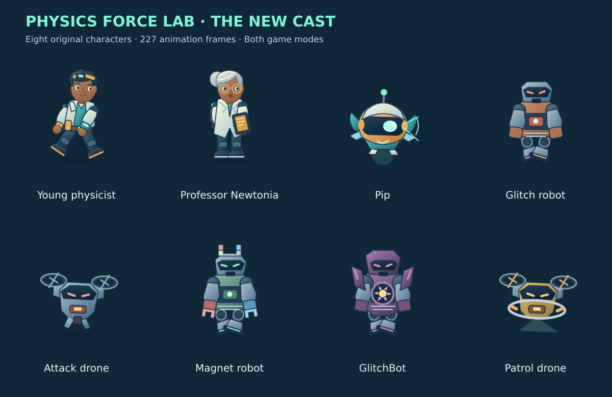

# Physics Force Lab v4.6 — The Animated Cast

All eight character roles now have newly illustrated transparent sprite sheets shared by the Adventure and original action labs. The young physicist has a teal field jacket, goggles, backpack and orange tool bracer. Professor Newtonia has silver hair, glasses, an ivory coat and a tablet. Pip is an expressive gold-and-teal companion. Glitch robots, attack drones, magnetic robots, GlitchBot and maintenance patrol drones each have distinct silhouettes, equipment and colours.

## Animation and integration

| Character | Frames | Clips |
| --- | ---: | --- |
| Young physicist | 47 | Idle, run, rise, fall, land, interact, cast, hurt, celebrate |
| Professor Newtonia | 24 | Idle, talk, gesture, celebrate |
| Pip | 22 | Hover, scan, cheer, recoil |
| Glitch robot | 30 | Idle, walk, attack, hurt, defeat |
| Attack drone | 22 | Hover, attack, hurt, defeat |
| Magnet robot | 30 | Idle, walk, attack, hurt, defeat |
| GlitchBot | 36 | Idle, walk, charge, fire, hurt, defeat |
| Patrol drone | 16 | Hover, scan, bump |

The library contains **227 frames in 40 clips**. Runtime states follow existing events: movement, take-off, descent, landing, station interaction, tool use, damage, repairs, enemy shots and boss attacks. Newtonia talks near the workshop; Pip follows the scientist and scans or celebrates. Non-colliding defeat animations play after the existing reward/removal event, so enemy defeat and boss progression remain immediate. Some additional library poses are available for later story scenes; the table lists the complete library, not a claim that every pose has a new gameplay trigger.

Each sheet uses 160×192 padded cells, a common feet anchor and per-character body bounds. Rendering mirrors around the body centre without changing collision dimensions. Artwork comes from original SVG rigs in `tools/physics-character-art.cjs`; no external artwork or new dependencies are required. Run `node tools/build-physics-characters.cjs` from the repository root to regenerate the sheets, metadata and cast preview with the existing Sharp dependency. Source hashes in the metadata make stale artwork source fail CI. Generated images are committed, so normal builds and the lightweight game CI do not need Sharp installed.

The eight atlases total approximately **1.60 MiB** of PNG downloads and **28.1 MiB** of decoded RGBA pixels. Adventure requests only its four roles; the original labs request their seven roles. Loads are cached and image dimensions are validated. Existing procedural actors remain available if a sheet or the animation module cannot load. Pausing freezes animation clocks, and reduced motion uses stable poses while movement and controls continue working. Damage uses a steady translucent pose rather than rapid player flashing.

Thirty Adventure missions, ninety investigations, twelve original labs, all previous backgrounds, audio, original asset files, level geometry, collision bodies, educational models, controls and save formats remain intact. Animation clocks and defeat effects are not persisted. The public game details already describe the completed campaign and are unchanged. No other game, website layout or Cloudflare configuration changes.

## Exact files

Modified:

- `.github/workflows/physics-force-lab.yml`
- `apps/web/public/games/physics-force-lab/adventure.js`
- `apps/web/public/games/physics-force-lab/game.js`
- `apps/web/public/games/physics-force-lab/game.json`
- `apps/web/public/games/physics-force-lab/index.html`
- `apps/web/public/games/physics-force-lab/legacy-visuals.js`
- `apps/web/public/games/physics-force-lab/original-labs.html`

Added:

- `tools/physics-character-art.cjs`
- `tools/build-physics-characters.cjs`
- `apps/web/public/games/physics-force-lab/character-sprite-data.js`
- `apps/web/public/games/physics-force-lab/character-sprites.js`
- `apps/web/public/games/physics-force-lab/assets/characters/player.png`
- `apps/web/public/games/physics-force-lab/assets/characters/professor.png`
- `apps/web/public/games/physics-force-lab/assets/characters/helper.png`
- `apps/web/public/games/physics-force-lab/assets/characters/glitch.png`
- `apps/web/public/games/physics-force-lab/assets/characters/drone.png`
- `apps/web/public/games/physics-force-lab/assets/characters/magnetBot.png`
- `apps/web/public/games/physics-force-lab/assets/characters/boss.png`
- `apps/web/public/games/physics-force-lab/assets/characters/maintenance.png`
- `apps/web/scripts/physics-characters.test.cjs`
- `apps/web/scripts/physics-characters-browser.cjs`
- `docs/releases/physics-force-lab-v4.6-cast.png`
- `docs/releases/physics-force-lab-v4.6.md`

## Validation

- 78 Physics checks plus 13 shared score/fullscreen and 25 game-page/Sky Temple checks: **116 automated checks**. New tests decode every used PNG frame, check transparency and edge padding, verify changing pose pixels, enforce frame/download/memory budgets and source hashes, and exercise animation clocks, crop bounds, mirroring, reduced motion, cached loads and failure fallback.
- A dedicated browser harness checks actual runtime bindings for player movement/tool/damage, all three original enemy classes, immediate defeat scoring, boss charge/fire/hurt/defeat, Adventure station interaction, repair celebration state, patrol contact, NPC speech, paused clocks and reduced-motion frames. It also confirms both games remain playable when atlas requests or the sprite module are blocked. These isolated fixtures inspect the served closure locally; no production QA hook or progression shortcut is added.
- Both modes pass layout checks at 320×568, 360×740, 375×667, 390×844, 568×320, 844×390, 768×1024, 1024×768 and 1440×900. The original regression harness checks concurrent touch movement/jump, rotation, quiz completion, pause, reduced motion, preserved saves and all twelve level-building fixtures. Adventure smoke tests complete a repair through actual movement and experiment controls at phone portrait and small landscape sizes, and check unavailable storage/audio and optional diagram fallback. Passing browser runs report no uncaught JavaScript errors.
- The complete thirty-mission playthrough was performed for v4.5. This graphics increment uses the focused animation and gameplay regressions above; it does not claim a new full manual campaign playthrough. Original level/question preservation checks continue to pass.
- The cast, phone Adventure/original views and small-landscape boss view are visually inspected. Next.js production build, JavaScript syntax, HTML IDs and references, JSON, existing CSS parsing, asset references and diff whitespace checks pass.

Run `node --test apps/web/scripts/physics-*.test.cjs`. With `PLAYWRIGHT_PATH` and `CHROME_BIN` set, run `node apps/web/scripts/physics-characters-browser.cjs`, `node apps/web/scripts/physics-legacy-browser.cjs` and `PHYSICS_SMOKE=1 node apps/web/scripts/physics-browser.cjs`.

## Installation

After the feature PR merges, pull `main` and build/deploy through the existing Cloudflare/OpenNext setup when ready. No ZIP, publication staging files, data migration or deployment configuration change is needed. Cloudflare deployment remains with the owner; local and GitHub validation are not a production deployment claim.
